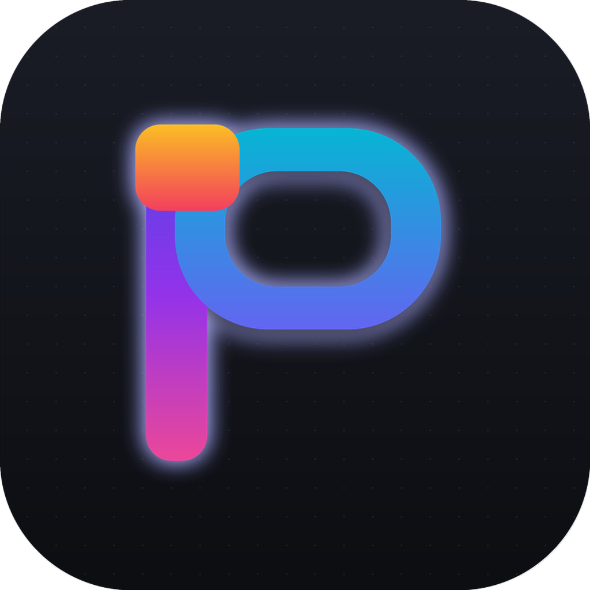
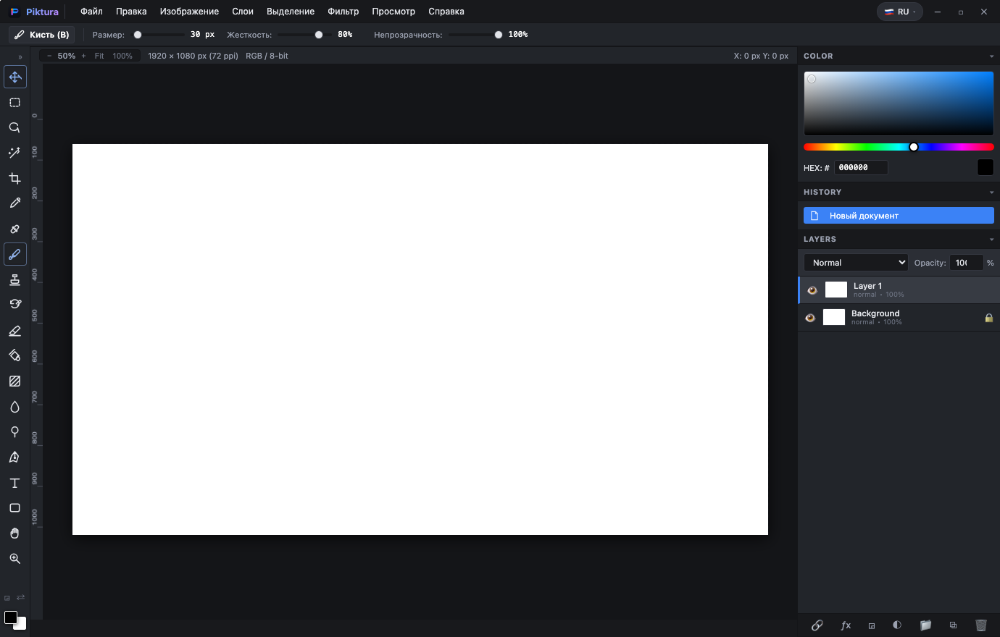

<div align="center">



# 🎨 Piktura Studio
### The Next-Gen, Native, Lightweight Photoshop Alternative for macOS & Creative Pros

[](https://github.com/GhostOS-ai/Piktura/releases)
[](https://github.com/GhostOS-ai/Piktura/releases)
[-purple)](https://github.com/GhostOS-ai/Piktura)
[](https://github.com/GhostOS-ai/Piktura)
[](https://github.com/GhostOS-ai/Piktura)
[](https://github.com/GhostOS-ai/Piktura)
[](LICENSE)
[](https://github.com/GhostOS-ai)

**100% Offline • Apple Silicon Native • Authentic Photoshop Ergonomics • Zero Telemetry • Zero Subscriptions**

<p align="center">
  <a href="#-english">🇺🇸 English</a> •
  <a href="#-русский">🇷🇺 Русский</a> •
  <a href="#-қазақша">🇰🇿 Қазақша</a> •
  <a href="#-español">🇪🇸 Español</a> •
  <a href="#-deutsch">🇩🇪 Deutsch</a> •
  <a href="#-français">🇫🇷 Français</a> •
  <a href="#-简体中文">🇨🇳 简体中文</a> •
  <a href="#-日本語">🇯🇵 日本語</a> •
  <a href="#-português">🇵🇹 Português</a>
</p>

</div>

---

<div align="center">



*Piktura Studio running natively on macOS with Photoshop-grade top Options Bar, dockable left toolbar, interactive on-canvas text engine, dynamic visual indicators, and live multi-layer stack.*

</div>

---

## ⚡ Quick Download

| Asset | Platform | Architecture | Link |
| :--- | :--- | :--- | :--- |
| **Piktura Studio v1.1.3** | macOS 11.0+ (Big Sur – Sequoia) | Apple Silicon (M1 / M2 / M3 / M4) | [⬇️ Download `.zip`](https://github.com/GhostOS-ai/Piktura/releases/latest/download/Piktura-macOS-AppleSilicon.zip) |

```bash
# Quick run from terminal
git clone https://github.com/GhostOS-ai/Piktura.git
cd Piktura
python3 -m pip install pywebview pyobjc-framework-Cocoa
python3 piktura_app.py
```

---

## 🛠️ The 20 Classic Photoshop Tools

| Tool | Icon | Hotkey | Function & Ergonomics |
| :--- | :---: | :---: | :--- |
| **Move Tool** | ✥ | `V` | Canvas content dragging, layer repositioning & 8-handle Free Transform (`⌘T`) |
| **Rectangular Marquee** | ⬚ | `M` | Pixel selection with live marching ants, dimension badge ($W \times H$), and `Esc` to Deselect |
| **Lasso Tool** | ⚲ | `L` | Freeform organic lasso selection with dynamic dashed outline trail |
| **Magic Wand** | 🪄 | `W` | Contiguous & non-contiguous color selection with customizable tolerance slider |
| **Crop Tool** | ⌗ | `C` | Freeform & fixed ratio (1:1, 4:3, 16:9), Rule of Thirds grid, `Enter` to commit, `Esc` to cancel |
| **Eyedropper** | 💧 | `I` | 1×1, 3×3, 5×5 canvas sampling with floating loupe preview and instant HEX readout |
| **Spot Healing Brush** | 🩹 | `J` | Retouching & smart neighborhood blending for blemishes, dust, and imperfections |
| **Brush Tool** | 🖌 | `B` | Photoshop-grade brush engine with dynamic high-contrast ring cursor, hardness, opacity & flow |
| **Clone Stamp** | ☖ | `S` | Sample source point via `⌥ Option/Alt + Click`, live crosshair indicator and clone painting |
| **History Brush** | ↺ | `Y` | Non-destructive painting back to prior document history states |
| **Eraser Tool** | ▱ | `E` | Alpha erasing with variable brush diameter, hardness, and smooth opacity |
| **Paint Bucket** | 🪣 | `G` | Fast flood-fill algorithm with tolerance thresholds and contiguous boundary search |
| **Gradient Tool** | ▨ | `G` | Linear & radial gradient engine with foreground/background & transparent color ramps |
| **Blur / Sharpen** | 💧 | `R` | Localized pixel smoothing (Gaussian) and unsharp edge enhancement |
| **Dodge / Burn** | 🏓 | `O` | Tonal exposure adjustments: Dodge (lighten highlights) and Burn (deepen shadows) |
| **Pen Tool** | ✒ | `P` | Bezier vector anchor points, path construction, and instant conversion to selection |
| **Horizontal Type** | **T** | `T` | **Photoshop-grade on-canvas text editing** (26+ fonts, bold, italic, alignment, live color) |
| **Shape Tools** | ▢ | `U` | Vector rectangles, rounded rectangles, ellipses, and geometric shapes |
| **Hand Tool** | ✋ | `H` / `Space` | Smooth pan and navigate high-resolution canvas at any zoom level |
| **Zoom Tool** | 🔍 | `Z` | Interactive zoom in/out with scrubby magnification and Fit to Screen (`⌘0`) |

---

## 🇺🇸 English

### The Creative Editor Built for Designers Who Value Speed & Privacy
Modern design tools have either drifted into bloated web subscription traps or over-simplified tablet interfaces that hide critical controls inside floating sheets. **Piktura Studio** brings back the golden age of desktop creativity:

- **Photoshop Ergonomics:** The classic, battle-tested layout designers know by heart. A real Top Options Bar that updates with every tool, a 1-column/2-column dockable Left Toolbar, a multi-layer stack with blend modes, and a dedicated History panel.
- **In-Place Canvas Typography:** Click anywhere on the canvas to edit text directly with blinking caret and selection. Choose from **26+ built-in professional fonts**, adjust font size (`pt`), toggle **Bold (B)** and *Italic (I)*, set alignment (*Left, Center, Right*), and pick colors with the native macOS palette. Commit with `⌘ + Enter` or cancel with `Escape`.
- **Live Canvas Feedback:** Marching ants for selections with real-time dimension tags, freeform dashed lasso trails, a Rule of Thirds crop box, a high-contrast circular brush ring with center dot, and an eyedropper loupe.
- **Instant Launch & Ultra-Lightweight:** Launches in under 0.4 seconds on Apple Silicon. Idles at under 60 MB RAM. Zero background update daemons, zero telemetry, and 100% offline.
- **Apple Silicon Native:** Optimized for M1/M2/M3/M4 with Metal GPU canvas acceleration and Apple Human Interface Guidelines squircle design.

---

## 🇷🇺 Русский

### Профессиональный графический редактор для тех, кто ценит скорость и приватность
Современные программы либо превратились в тяжеловесные «подписочные комбайны», либо спрятали профессиональные инструменты в неудобные выпадающие панели. **Piktura Studio** возвращает классическую эргономику Adobe Photoshop в сверхлёгком, быстром и нативном исполнении:

- **Фотошоп-эргономика рабочего места:** Привычная рабочая среда, знакомая миллионам дизайнеров и фотографов. Настоящая верхняя панель параметров (Options Bar), переключаемый тулбар слева (1 или 2 колонки), стек слоёв с режимами наложения (Multiply, Screen, Overlay и др.) и история действий.
- **Интерактивный текст на холсте (In-Place Typography):** Кликните в любое место холста для прямого ввода текста с живым курсором и выделением. **26+ встроенных шрифтов** (Apple SF Pro, Helvetica Neue, Inter, Georgia, Futura, Baskerville, Menlo и др.), пошаговый размер в pt, кнопки **Жирный (B)** и *Курсив (I)*, выравнивание (*по левому краю, по центру, по правому краю*) и нативная палитра цветов macOS. Подтверждение по `⌘ + Enter`, отмена по `Escape`.
- **Интерактивные визуальные индикаторы:** Анимированные «бегущие муравьи» с бейджем размеров ($W \times H$), пунктирный след лассо, рамка кадрирования с сеткой правила третей, высококонтрастный курсор-кольцо кисти и плавающая лупа пипетки.
- **Мгновенный старт и легковесность:** Запуск менее чем за 0.4 секунды. Потребление памяти менее 60 МБ RAM. Никаких фоновых сервисов Creative Cloud, никакой телеметрии, 100% офлайн и без ежемесячных подписок.
- **Создано для Apple Silicon:** Полная нативная поддержка процессоров Apple M1/M2/M3/M4, аппаратное ускорение и дизайн иконки по стандартам Apple HIG.

---

## 🇰🇿 Қазақша

### Жылдамдық пен құпиялылықты бағалайтындарға арналған кәсіби графикалық редактор
Заманауи редакторлар не тым ауыр жазылымдық бағдарламаларға айналды, не кәсіби құралдарды ыңғайсыз қалқымалы терезелерге жасырып тастады. **Piktura Studio** Adobe Photoshop-тың классикалық эргономикасын жеңіл, жылдам әрі нативті форматта қайтарады:

- **Фотошоп эргономикасы:** Әлемдік дизайнерлерге жақсы таныс классикалық интерфейс: нақты жоғарғы баптаулар панелі (Options Bar), сол жақтағы 1 немесе 2 бағанды құралдар панелі, қабаттар стегі (Multiply, Screen, Overlay және т.б.) және әрекеттер тарихы.
- **Кенептегі интерактивті мәтін (In-Place Typography):** Мәтін енгізу үшін кенептің кез келген жерін басып, курсормен тікелей жазыңыз. **26+ кірістірілген қаріп** (Apple SF Pro, Helvetica Neue, Inter, Georgia, Futura және т.б.), pt өлшемі, **Қалың (B)** және *Көлбеу (I)* батырмалары, мәтінді туралау және macOS түстер палитрасы. Растау — `⌘ + Enter`, бас тарту — `Escape`.
- **Интерактивті кенеп индикаторлары:** Көлем бейджі бар белгілеу аймағы ($W \times H$), лассо үзік сызығы, үштік ережесі бар қию жақтауы, контрастты қылқалам сақинасы және түс таңдау лупасы.
- **Шұғыл іске қосылу және жеңілдік:** 0.4 секундта ашылады. Жүйелік жадты 60 МБ-тан аз тұтынады. Фондық жаңартулар мен деректерді сыртқа жіберу жоқ, 100% офлайн және ай сайынғы төлемсіз.
- **Apple Silicon үшін оңтайландырылған:** Apple M1/M2/M3/M4 чиптерінде аппараттық жылдамдықпен жұмыс істейді.

---

## 🇪🇸 Español

### El Editor Creativo Diseñado para Quienes Valoran Velocidad y Privacidad
Las herramientas de diseño modernas se han convertido en pesadas suscripciones web o han simplificado demasiado los controles profesionales. **Piktura Studio** recupera la ergonomía clásica de Photoshop en un formato ligero y nativo:

- **Ergonomía Clásica de Photoshop:** Barra de opciones superior interactiva, barra de herramientas lateral adaptable (1 o 2 columnas), panel de capas con modos de fusión completos (*Multiplicar, Trama, Superponer, etc.*) y panel de historial de acciones.
- **Tipografía Directa en Lienzo:** Haz clic en cualquier lugar del lienzo para escribir y editar texto con cursor activo. Más de **26 fuentes profesionales incluidas**, tamaño en pt, botones de **Negrita (B)** y *Cursiva (I)*, alineación y selector de color nativo de macOS. Confirmación con `⌘ + Enter`, cancelación con `Escape`.
- **Indicadores Visuales en Tiempo Real:** Hormigas marchantes con etiqueta de tamaño ($W \times H$), trazado discontinuo de lazo, cuadrícula de regla de tercios para recortar, cursor circular de pincel de alto contraste y lupa de cuentagotas.
- **Inicio Instantáneo (<0.4s):** Sin demonios en segundo plano, consumo mínimo de memoria RAM (<60 MB), 100% offline y sin pagos mensuales.
- **Nativo para Apple Silicon:** Aceleración por GPU en procesadores M1/M2/M3/M4 y diseño de icono squircle según las guías Apple HIG.

---

## 🇩🇪 Deutsch

### Professioneller Grafikeditor mit echter Photoshop-Ergonomie & Offline-Fokus
Viele moderne Bildbearbeitungsprogramme verstecken Profi-Funktionen in verschachtelten Menüs oder erfordern teure Abonnements. **Piktura Studio** bringt die bewährte Desktop-Kreativität zurück:

- **Echte Photoshop-Ergonomie:** Werkzeugleiste oben (Options Bar), anpassbare linke Werkzeugleiste (1 oder 2 Spalten), Ebenen-Manager mit Füllmethoden (*Multiplizieren, Negativ multiplizieren, Ineinanderkopieren usw.*) und vollständiges Protokoll.
- **Direkte Textbearbeitung auf der Leinwand:** Klicken Sie an eine beliebige Stelle, um Text direkt mit blinkendem Cursor einzugeben. Über **26 integrierte Schriftarten**, Schriftgröße in pt, **Fett (B)** und *Kursiv (I)*, Textausrichtung und native macOS-Farbpalette. Bestätigen mit `⌘ + Enter`, Abbrechen mit `Escape`.
- **Live-Feedback auf der Arbeitsfläche:** Animierte Auswahlrahmen mit Maßangaben ($W \times H$), Lasso-Pfade, Drittelregel-Freistellungsraster, kontrastreicher Pinselring-Cursor und Pipetten-Lupe.
- **Blitzschneller Start (<0.4s):** Extrem ressourcenschonend (<60 MB RAM), ohne Cloud-Hintergrunddienste, 100% offline und dauerhaft abofrei.
- **Optimiert für Apple Silicon:** Native Unterstützung für Apple M1/M2/M3/M4 Prozessoren und Apple HIG Icon-Ästhetik.

---

## 🇫🇷 Français

### L'Éditeur Graphique Performant Pensé pour les Créatifs Exigeants
Les logiciels contemporains sont souvent surchargés d'abonnements ou simplifiés à l'excès. **Piktura Studio** réinvente l'ergonomie classique de Photoshop dans une application de bureau ultralégère :

- **Ergonomie Authentique Photoshop :** Barre d'options contextuelle supérieure, barre d'outils latérale (1 ou 2 colonnes), pile de calques avec modes de fusion complets (*Produit, Superposition, Incrustation, etc.*) et panneau d'historique.
- **Édition de Texte Directe sur la Toile :** Cliquez n'importe où pour saisir et modifier du texte en temps réel. Plus de **26 polices professionnelles intégrées**, taille en pt, boutons **Gras (B)** et *Italique (I)*, alignement et palette de couleurs native macOS. Validez avec `⌘ + Enter`, annulez avec `Escape`.
- **Indicateurs Visuels Interactifs :** Lignes pointillées animées avec affichage des dimensions ($W \times H$), tracé dynamique du lasso, grille de recadrage à la règle des tiers, curseur circulaire haute visibilité et loupe de pipette.
- **Lancement Instantané (<0.4s) :** Consomme moins de 60 Mo de mémoire vive, sans processus d'arrière-plan invasifs, 100% hors ligne et sans abonnement.
- **Natif Apple Silicon :** Conçu pour tirer parti de la puissance des puces Apple M1/M2/M3/M4 et respectant les lignes directrices Apple HIG.

---

## 🇨🇳 简体中文

### 专为注重速度与隐私的设计师打造的原生轻量级图像创作套件
许多现代设计工具要么变成庞大的订阅制云端软件，要么过度简化了专业控制。**Piktura Studio** 将经典的 Photoshop 桌面人机工学体验以超轻量、极致迅速的方式呈现：

- **纯正 Photoshop 经典操作逻辑：** 顶部属性选项栏（Options Bar）随工具即时更新，左侧支持单/双列停靠工具栏，图层面板支持丰富混合模式（正片叠底、滤色、叠加等），并配备完整历史记录面板。
- **画布即时文本排版（In-Place Typography）：** 点击画布任意位置即可就地输入与编辑文本，具备动态光标与选区。内置 **26+ 款专业字体**，支持点数（pt）字号调节、**加粗（B）**与*斜体（I）*切换、对齐方式以及 macOS 原生拾色器。快捷键 `⌘ + Enter` 确认，`Escape` 取消。
- **实时画布视觉反馈：** 动态蚂蚁线选区伴随实时尺寸标签（$W \times H$），套索虚线轨迹，三分法则裁剪网格，高对比度双色画笔圆环光标，以及吸管取色放大镜。
- **秒速启动与超低内存消耗：** 启动时间低于 0.4 秒，内存占用通常低于 60 MB。无后台遥测，无云端常驻进程，100% 离线运行，零订阅费用。
- **Apple Silicon 原生加速：** 针对 M1/M2/M3/M4 系列芯片深度优化，遵循 Apple 人机交互规范（HIG）设计。

---

## 🇯🇵 日本語

### スピードとプライバシーを重視するクリエイターのための次世代グラフィックエディタ
サブスクリプションの肥大化や機能の過度な単純化とは対照的に、**Piktura Studio** は長年培われた Photoshop のクラシックなデスクトップ操作性を、超軽量かつ高速なネイティブアプリとして再現します：

- **Photoshop 準拠の本格的な操作感：** 各ツールに連動する上部オプションバー、1列/2列切り替え可能な左ツールバー、豊富な描画モード（乗算、スクリーン、オーバーレイなど）対応レイヤースタック、履歴パネルを完備。
- **キャンバス上の直接テキスト入力・編集：** キャンバスの任意の場所をクリックするだけで、文字入力や範囲選択が直接行えます。**26種類以上の内蔵フォント**、pt単位のフォントサイズ変更、**太字（B）**や*斜体（I）*の切り替え、行揃え、macOS ネイティブカラーピッカー連携に対応。`⌘ + Enter` で確定、`Escape` でキャンセル。
- **インタラクティブなキャンバス表示：** サイズ表示（$W \times H$）付きのマーチングアンツ選択範囲、なげなわツールの点線ガイド、三分割法構図グリッド付きトリミング、高コントラストなブラシリングカーソル、スポイト拡大鏡プレビューを搭載。
- **0.4秒未満の高速起動＆省メモリ設計：** 常駐プロセスやデータ収集は一切なし。メモリ消費量は 60MB 未満、完全オフライン、永久にサブスクリプション不要。
- **Apple Silicon ネイティブ対応：** M1/M2/M3/M4 チップに最適化され、Apple HIG に準拠した美しいアイコンデザインを採用。

---

## 🇵🇹 Português

### O Editor Gráfico Profissional para Quem Valoriza Velocidade e Privacidade
As ferramentas de design modernas tornaram-se assinaturas pesadas ou esconderam controlos essenciais. O **Piktura Studio** recupera a ergonomia clássica do Photoshop numa aplicação leve, rápida e nativa:

- **Ergonomia Autêntica de Photoshop:** Barra de opções superior interativa, barra de ferramentas lateral adaptável (1 ou 2 colunas), gestor de camadas com modos de mesclagem completos (*Multiplicar, Ecrã, Sobrepor, etc.*) e histórico de ações.
- **Tipografia Direta na Tela:** Clique em qualquer ponto da tela para escrever e editar texto em tempo real com cursor ativo. Mais de **26 tipos de letra profissionais incluídos**, tamanho em pt, botões de **Negrito (B)** e *Itálico (I)*, alinhamento e seletor de cores nativo do macOS. Confirmação com `⌘ + Enter`, cancelamento com `Escape`.
- **Indicadores Visuais Interativos:** Linhas pontilhadas com etiqueta de dimensões ($W \times H$), rasto de laço, grelha de regra dos terços para recorte, cursor circular de pincel de alto contraste e lupa de conta-gotas.
- **Início Instantâneo (<0.4s):** Consumo de memória mínimo (<60 MB RAM), sem processos em segundo plano, 100% offline e sem custos de assinatura.
- **Nativo para Apple Silicon:** Aceleração nos processadores Apple M1/M2/M3/M4 e ícone de acordo com as diretrizes Apple HIG.

---

## ⌨️ Essential Keyboard Shortcuts

| Shortcut | Action | Shortcut | Action |
| :--- | :--- | :--- | :--- |
| `⌘ + N` | New Document | `V` | Move Tool |
| `⌘ + O` | Open File / Image | `M` | Rectangular Marquee |
| `⌘ + S` | Save / Export | `L` | Lasso Tool |
| `⌘ + Z` | Undo | `W` | Magic Wand Tool |
| `⌘ + ⇧ + Z` | Redo | `C` | Crop Tool |
| `⌘ + T` | Free Transform Layer | `B` / `E` | Brush / Eraser Tool |
| `⌘ + J` | Duplicate Active Layer | `S` / `Y` | Clone Stamp / History Brush |
| `⌘ + E` | Merge Layer Down | `G` | Paint Bucket & Gradient |
| `⌘ + D` / `Esc` | Deselect Active Selection | `T` | Horizontal Type Tool |
| `⌘ + 0` | Fit Canvas to Screen | `H` / `Space` | Hand Tool (Pan Viewport) |
| `⌘ + +` / `⌘ + -` | Zoom In / Zoom Out | `Z` | Zoom Tool |

---

## 🛠️ Build & Development

```bash
# Clone the repository
git clone https://github.com/GhostOS-ai/Piktura.git
cd Piktura

# Install Python requirements
python3 -m pip install pywebview pyobjc-framework-Cocoa pyinstaller

# Run live development mode
python3 piktura_app.py

# Compile standalone macOS Application bundle (Piktura.app)
pyinstaller Piktura.spec --noconfirm
```

The resulting bundle is written to `dist/Piktura.app`.

---

## 📜 License & Acknowledgments

- **License:** Distributed under the permissive [MIT License](LICENSE).
- **Author:** Created with passion by [KIB.best](https://github.com/GhostOS-ai).
- **Repository:** [github.com/GhostOS-ai/Piktura](https://github.com/GhostOS-ai/Piktura)
- **Contact:** [GhostOS@kib.best](mailto:GhostOS@kib.best)

<div align="center">
<sub>Piktura Studio • Crafted with dedication by KIB.best • 2026</sub>
</div>
